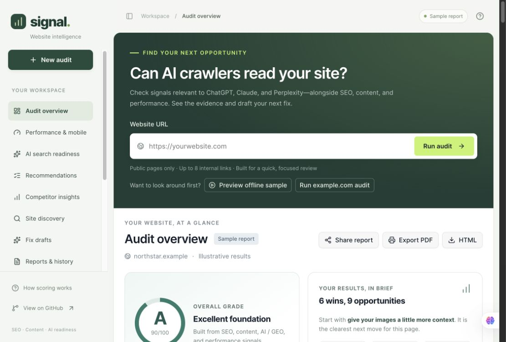

# Signal — SEO, Content & AI Search Readiness Audit

Signal audits a public webpage and turns bounded technical and content evidence into transparent scores and practical next steps. It does not predict rankings or AI citations.

[**Try the live app**](https://signal-audit-lab.shabeehshah42.chatgpt.site) · [**Download source**](https://github.com/shabeeh-shah/SEO-Audit-Tool/archive/refs/heads/main.zip) · [Releases](https://github.com/shabeeh-shah/SEO-Audit-Tool/releases) · [Report an issue](https://github.com/shabeeh-shah/SEO-Audit-Tool/issues)

[](https://github.com/shabeeh-shah/SEO-Audit-Tool/actions/workflows/ci.yml) · **MIT License** · **Public beta v0.1.0**

## What it checks

- **SEO:** title and meta description presence and length, H1 and heading hierarchy, canonical and indexing directives, language and viewport tags, Open Graph and Twitter tags, image alt attributes, HTTPS, redirect chains, sampled broken internal links, robots.txt and sitemap.xml availability, hreflang shape, and selected security headers.
- **Content:** extracted word count, English Flesch reading ease when enough text is available, repeated sentences, paragraph length, common terms, and heading structure.
- **AI search readiness:** robots.txt rules for GPTBot, ClaudeBot, PerplexityBot, Google-Extended, and CCBot; JSON-LD syntax and Organization, FAQPage, Article, and Product declarations; question-style headings with concise answers; author and date signals; snippet controls; and optional, unscored llms.txt availability.
- **Performance and mobile:** initial HTML response time and size, markup-level bottlenecks, up to six image-header samples, declared lazy loading, viewport and fixed-width risks, and an experimental 390 px sandboxed preview. The preview executes page JavaScript and attempts rendered word count, FCP, LCP, CLS, overflow, tap-target, oversized-image, and selected axe-core accessibility diagnostics.
- **Separate tools:** a sitemap-first same-origin audit of 10, 25, or 50 pages with per-page results and a site-wide summary; a bounded bulk comparison of up to 20 public URLs with CSV export; comparison with up to two competitor pages; optional CrUX page-level mobile field data when a server-only API key is configured; stateless summary permalinks with LinkedIn and PNG sharing; HTML/JSON/CSV downloads; white-label print-to-PDF with client-side branding; and browser-local audit history with comparisons.

The site-wide audit checks broken internal destinations within its bounded page set, redirect chains, canonical conflicts, duplicate titles and meta descriptions, hreflang syntax and sampled return links, Open Graph and Twitter fields, selected security response headers, and basic server-HTML accessibility signals. It discovers sitemap entries first and falls back to permitted internal links, with three concurrent page fetches and one retry for temporary network failures.

Every finding includes evidence and a plain-language next step. Sitemap contents are not validated by the quick audit, and sampled checks do not claim complete site coverage.

## Screenshot placeholder



Replace `docs/signal-dashboard.jpg` after meaningful interface changes so the repository preview stays current.

## Quick start

Signal requires Node.js 22.13 or newer.

```sh
git clone https://github.com/shabeeh-shah/SEO-Audit-Tool.git
cd SEO-Audit-Tool
npm ci
npm run dev
```

Open the local address printed by the development server. **Preview offline sample** and **Explore sample comparison** use bundled fictional data without making an audit request. `demo.html` is a lightweight visual demo rather than the complete audit engine.

Before submitting a change, run:

```sh
npm run typecheck
npm run lint
npm test
npm run build
```

The CLI source is included but is not published to npm:

```sh
node packages/cli/bin/signal-audit.mjs --sample
node packages/cli/bin/signal-audit.mjs https://your-public-site.com --output report.json
```

The repository also includes a composite GitHub Action, an unpacked Chrome extension, and a stateless `/mcp` endpoint. Their setup and availability are documented in their source folders; no Chrome Web Store or npm release is claimed.

## How scoring works

Each scored check has a visible weight and one of three point values:

```text
Good = 100
Improvement = 55
Critical = 0

category score = round(sum(check weight × status points) / sum(check weights))
overall score = round((SEO + Content + AI/GEO + Performance) / 4)
```

Checks with weight `0` are advisory. Optional findings, including llms.txt, never reduce the score or enter the top-fix list. A link result with no conclusive response is advisory, and readability is advisory when the page does not provide enough declared-English prose. Historical reports store the scoring version and warn when compared runs use different scored checks.

The score summarizes this documented ruleset. It does not predict or guarantee indexing, rankings, traffic, crawler visits, AI visibility, or AI citations. Every check’s category, label, and weight lives in the single scoring configuration at [`lib/audit/scoring.ts`](lib/audit/scoring.ts); observed thresholds and evidence live in [`lib/audit/analyze.ts`](lib/audit/analyze.ts), and the verification fixtures live in [`scripts/`](scripts/).

## Limitations

- A quick audit inspects one HTML page, up to 8 internal links, and up to 6 image headers. The separate site-wide audit defaults to 25 same-origin pages, can be set from 10 to 50 in the interface, stops after 40 seconds, and clearly reports partial coverage. Broken-link and reciprocal-hreflang findings cover only destinations included in that bounded crawl.
- HTML is capped at 1.5 MB, redirects at 3, and individual fetches at 15 seconds. In-memory per-connection/server-instance rate limits apply. Slow, blocked, oversized, and unreachable sites return explicit errors.
- Only public HTTP(S) URLs are accepted. Local and private addresses, credentials, and custom ports are rejected; DNS and every redirect are revalidated. The fetcher respects applicable robots.txt rules and identifies itself with a clear User-Agent.
- The sandboxed browser preview can differ from the original because of cookies, cross-origin resources, and script restrictions. Its measurements are diagnostics, not Lighthouse or official real-user Core Web Vitals. INP is not simulated.
- Real-user mobile LCP, INP, and CLS require a server-only `CRUX_API_KEY` and sufficient Chrome UX Report coverage. Field data never changes the heuristic score.
- Competitor phrases, heading gaps, and intent labels are lexical heuristics. They do not use search volume, keyword difficulty, ranking, or semantic-equivalence data.
- Browser history stores up to 100 successful runs or 3 MB on the current browser and origin. It does not sync across devices. Share links are public and encode only the public page URL, overall score, four category scores, and up to three fix titles; no report is stored server-side.
- Bulk mode accepts up to 20 URLs, processes two concurrently, and is rate limited to one batch per minute per connection and server instance. Each URL still uses the quick audit’s robots, timeout, response-size, redirect, and public-address controls. Results are returned to the browser and are not stored server-side.
- White-label company names and PNG, JPEG, or WebP logos stay in the active browser tab and are embedded only in generated HTML or PDF output. Logos are limited to 1 MB in the interface; there is no server upload.
- Automated accessibility findings do not replace manual keyboard, screen-reader, contrast, or usability testing.

## Roadmap

- Add richer duplicate-content and structured-data validation while keeping crawl scope and partial results visible.
- Improve before-and-after reporting, scheduled monitoring, and portable history import.
- Prepare the CLI and browser extension for separate reviewed releases.
- Keep AI-readiness guidance aligned with published provider documentation without turning optional conventions into ranking claims.

## Contributing

Open a focused issue or pull request. Every new feature needs tests, and changes must preserve the existing URL-safety and SSRF protections. Do not add third-party network calls without prior discussion. Keep findings evidence-based and avoid ranking or AI-citation predictions.

Run typecheck, lint, tests, and build before submitting. Report security issues privately to the repository owner rather than in a public issue.

Signal is [MIT licensed](LICENSE), Copyright © 2026 Shabeeh Shah. Third-party packages retain their own licenses; the vendored axe-core license is in [`public/vendor/AXE-LICENSE.txt`](public/vendor/AXE-LICENSE.txt).
