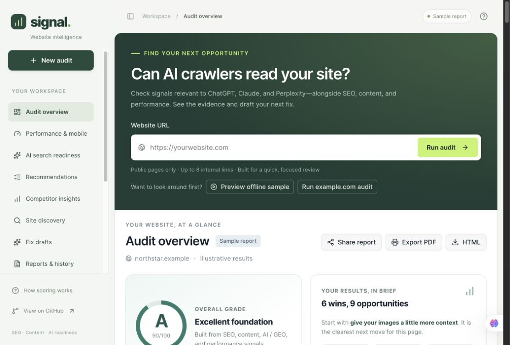

# Signal — SEO & AI Search Readiness

Can AI crawlers access your content? Signal turns public-page evidence into clear priorities and editable fixes.

[**Try the live app**](https://signal-audit-lab.shabeehshah42.chatgpt.site) · [**Download source**](https://github.com/shabeeh-shah/SEO-Audit-Tool/archive/refs/heads/main.zip) · [Releases](https://github.com/shabeeh-shah/SEO-Audit-Tool/releases) · [Report a bug](https://github.com/shabeeh-shah/SEO-Audit-Tool/issues)



[](https://github.com/shabeeh-shah/SEO-Audit-Tool/actions/workflows/ci.yml) · **MIT license** · **Public beta v0.1.0**

## What works today

- **SEO and content:** titles, descriptions, headings, canonical/indexing directives, language, viewport, social cards, image alt attributes, readability, and repeated copy.
- **AI readiness:** robots.txt rules for GPTBot, ClaudeBot, PerplexityBot, Google-Extended, and CCBot; JSON-LD syntax/types; question-and-answer structure; author/date signals. These agents have different purposes; this is not a complete list of AI search agents. `llms.txt` is explicitly optional and unscored.
- **Performance:** server HTML delivery, image header samples, and an experimental 390 px sandboxed browser preview that **executes page JavaScript** and attempts rendered word count, LCP/CLS/FCP, overflow, and tap-target diagnostics. axe-core checks the preview for selected WCAG A/AA violations. This is **not Lighthouse**, a compliance audit, or real-user Core Web Vitals.
- **Site discovery:** a separate, bounded crawl follows same-origin sitemap entries and links for up to 25 pages. It checks HTTP failures, redirects, duplicate titles, canonical conflicts, and hreflang return links among sampled pages. It reports partial coverage and never claims a full-site inventory.
- **Competitor insights:** compare one page with up to two competitors for recurring phrase ideas, heading gaps, structure, and estimated search intent. No search-volume, ranking, difficulty, or semantic-equivalence data.
- **Act on the results:** impact/effort sorting, copyable Organization JSON-LD, AI-bot robots rules, and editable meta descriptions. Drafts must match the actual business and publishing policy.
- **Keep and share:** public report permalinks, score preview images, print-to-PDF, HTML/JSON/CSV exports, and the last 10 audits saved in this browser with score/finding comparisons. Clear history removes local history; shared links are separate snapshots.

## Honest limits

**Free public beta:** quick audits inspect one HTML page, up to 8 links, and up to 6 image headers. Optional discovery inspects up to 25 pages in 40 seconds, with up to 3 sitemap files (200 KB each), same-origin URLs, and 3 parallel page requests. HTML is capped at 1.5 MB, redirects at 3, and individual fetches at 15 seconds. Blocked and timed-out pages are reported as unavailable, not as broken links.

The preview can differ substantially from the original site because of sandboxing, cookies, cross-origin resources, and script restrictions. Its CLS is a simple accumulated diagnostic, not the official session-window calculation. INP is not simulated. Unsupported metrics remain unavailable. Automated accessibility checks do not replace manual keyboard, screen-reader, or visual testing.

**Real field data** uses a separate Chrome UX Report API request: mobile, page-level p75 LCP/INP/CLS with its collection period. Configure server-only `CRUX_API_KEY` to enable it. Without a key, or when CrUX has insufficient coverage, Signal displays an explicit unavailable state and a PageSpeed Insights link. Field data never changes the heuristic score. Do not put API keys in client code.

Rate limits are in-memory, per IP/server instance: 5 audits, 3 comparisons, 1 discovery crawl, 1 field lookup, and 10 share operations per minute. They are not durable account quotas. Only public HTTP(S) domains are allowed. Local/private addresses, credentials, and custom ports are rejected. DNS is checked, redirects are revalidated, and crawler rules are checked before page fetches. Hosted Workers additionally enforce public-only egress. DNS checking alone is not a complete rebinding defense on an arbitrary Node host; keep the Worker egress guard when hosting the server.

No score guarantees indexing, rankings, traffic, crawler visits, or AI citations. [Google says special AI text files are not required for its AI search features](https://developers.google.com/search/docs/fundamentals/ai-optimization-guide).

## Start locally

Requires Node.js 22.13+.

```sh
git clone https://github.com/shabeeh-shah/SEO-Audit-Tool.git
cd SEO-Audit-Tool
npm ci
npm run dev
```

Open the URL printed by the development server. **Preview offline sample** and **Explore sample comparison** use bundled fictional data with no audit network request. To run the entire app without any internet, install dependencies first and serve the local build. The standalone `demo.html` remains a lightweight visual demo rather than the full live engine.

```sh
npm run typecheck
npm test
npm run build
```

## Checks and scoring

Signal reports a status for every check. A status is **Good**, **Improvement**, **Critical**, or **Optional**. Optional findings never reduce the score or enter the top-fix list. Some checks are advisory: they still show evidence and a next step, but are not used in the numeric score.

```text
category score = round(sum(check weight × status points) / sum(check weights))
status points: Good = 100, Improvement = 55, Critical = 0
overall score = round((SEO + Content + AI/GEO + Performance) / 4)
```

Checks with weight `0` are advisory. A link check with no conclusive response is also advisory, and readability is advisory when there is not enough declared-English prose to calculate it.

| Category | Check | What it reviews | Weight |
| --- | --- | --- | ---: |
| SEO | Title | A non-empty, single title tag; 20–65 characters is a review guide. Duplicates are checked separately among pages in the bounded discovery crawl. | 2 |
| SEO | Meta description | A non-empty, single page description; 70–170 characters is a review guide. | 1 |
| SEO | H1 | One non-empty main heading. | 1 |
| SEO | Heading outline | Heading-level jumps such as H1 to H3. | 1 |
| SEO | Image alt attributes | Images that have no `alt` attribute. | 2 |
| SEO | Indexing directives | `noindex` or `none` in meta robots or an applicable X-Robots-Tag. | 2 |
| SEO | Canonical | One usable canonical that resolves to the audited URL. | Advisory |
| SEO | HTTPS | Whether the final audited URL uses HTTPS. | 2 |
| SEO | Viewport | `width=device-width` in the viewport meta tag. | 1 |
| SEO | Language | A `lang` attribute on the HTML element. | 1 |
| SEO | Internal links | A focused sample of internal URLs that return 4xx/5xx responses. | 2 when conclusive |
| SEO | Redirect chains | More than one redirect for the page or a sampled internal link. | 1 |
| SEO | robots.txt | Successful response from `/robots.txt`; contents are not fully validated. | Advisory |
| SEO | sitemap.xml | Successful response from `/sitemap.xml`; contents are not validated. | Advisory |
| SEO | Social cards | Open Graph title, description, image, and Twitter card tags. | Advisory |
| SEO | Security headers | Presence of CSP, nosniff, referrer policy, and HTTPS HSTS; policy effectiveness is not validated. | Advisory |
| SEO | hreflang | URL and language-code shape; reciprocal checks only within the separate crawl. | Advisory |
| Performance | Initial page delivery | HTML response time and markup transfer size. | 2 |
| Performance | Large images | Up to 6 image URLs with a reported `Content-Length` over 300 KB, plus oversized rendered dimensions in the lab snapshot. | 2 |
| Performance | Bottlenecks | Potentially render-blocking scripts, stylesheet count, total scripts, and declared lazy loading. | 1 |
| Performance | Mobile usability | Device-width viewport, large fixed inline widths, 390 px overflow, and small tap-target signals. | 1 |
| Performance | Core Web Vitals | Isolated lab LCP and CLS diagnostics; FCP and load timing are also shown. INP and real-user field data are not simulated. | Advisory |
| Content | Text volume | Extracted likely-main-content text, with a 100-word review threshold. | 1 |
| Content | Reading ease | English Flesch reading-ease estimate when there are at least 100 words and 5 sentences. | 1 when scored |
| Content | Repetition | Sentences of at least 8 words that appear 3 or more times. | 1 |
| Content | Paragraph length | Paragraphs longer than 120 words. | 1 |
| AI/GEO | Text access | Essential server-delivered text, with a 50-word review threshold. | 2 |
| AI/GEO | Sections | H2 sections that organize the content. | 1 |
| AI/GEO | Answer format | Question-style headings followed by a concise 8–80 word paragraph. | Advisory |
| AI/GEO | JSON-LD | JSON syntax plus Organization, FAQPage, Article, or Product declarations. Invalid JSON-LD is scored. | 1 only for invalid JSON-LD |
| AI/GEO | Author and date | Author and publication/update signals in visible markup, metadata, or JSON-LD. | Advisory |
| AI/GEO | Snippet controls | `nosnippet` or `max-snippet:0` directives. | 1 |
| AI/GEO | AI crawler access | Basic robots.txt rules for GPTBot, ClaudeBot, PerplexityBot, Google-Extended, and CCBot. | Advisory |
| AI/GEO | llms.txt | Optional file availability, whether present or absent. No action is required. | Advisory |

The crawler, schema, answer, authorship, llms.txt, and social checks are useful structure signals. They do not guarantee indexing, AI visibility, or citations.

## Distribution and automation

### CLI

The CLI source is ready, but **has not been published to npm**. Do not assume a public package with the same name belongs to this project.

```sh
node packages/cli/bin/signal-audit.mjs --sample
node packages/cli/bin/signal-audit.mjs https://your-public-site.com --output report.json
node packages/cli/bin/signal-audit.mjs https://your-public-site.com --baseline report.json --max-drop 5 --min-score 70
npm pack ./packages/cli --ignore-scripts
```

Install the resulting tarball locally to use `signal-audit` / `npx --no-install signal-audit`. Live CLI calls send the URL to the public Signal service and use the server HTML checks. They do not execute the browser preview. [CLI options and exit codes](packages/cli/README.md).

### GitHub Action

After this revision is pushed, use this repository as a composite action; pin a reviewed commit for production. Example after the v0.1.0 tag is published:

```yaml
- uses: actions/checkout@v4
- uses: shabeeh-shah/SEO-Audit-Tool@v0.1.0
  with:
    url: https://your-public-site.com
    min-score: '70'
    baseline: previous-report.json
    max-drop: '5'
```

Omit `baseline` if you have no previous report. The action writes `signal-audit.json`; upload it with your workflow’s artifact step if desired. Network failure exits 2; threshold failure exits 1. Public service rate limits and availability apply.

### Chrome extension

[Load the unpacked extension](extension/README.md) to inspect the active page’s rendered HTML locally. It uses `activeTab` and `scripting`, with no persistent access to all sites. Opening a full public audit shares only the URL with Signal and requires a separate Run audit click. **No Chrome Web Store listing has been published.**

### MCP

The hosted app exposes a stateless JSON-response MCP endpoint at `/mcp`, with `audit_public_page` and `sample_audit`. It supports initialization, tool discovery, calls, and ping using protocol version 2025-06-18. GET streams and server-pushed notifications are not supported. The tool audits public pages only; output text is untrusted site data. Existing URL safety and audit rate limits apply. The browser’s WebMCP tool remains separate from this server endpoint. Sites manages its hosted MCP connection; connection testing is separate from deployment.

## Competitor methodology

Two- and three-word phrases must occur at least twice on a compared page and in a heading, and be absent from your extracted title/text. Heading gaps use 60% meaningful-token overlap; synonyms can be missed. Intent is an English title/heading phrase heuristic, not a search-results analysis. High priority means evidence on both compared pages; Medium means one. These suggestions never change the audit grade. Analysis is capped at 120,000 extracted characters and 100 headings; thin/truncated content is flagged. Comparison reports download separately.

## Prioritization

Impact and effort are editorial estimates, not measured traffic gains or completion times. Critical = impact 3; other issues with weight ≥2 = impact 2; remaining issues = impact 1. Tag/metadata fixes have effort 1, copy/schema/server-delivery/bundle work effort 3, and other checks effort 2. Default ordering uses impact ÷ effort, then severity and score weight. Optional findings do not enter the top three fixes. Severity sorting is also available.

## Configuration and release

The current hostname is intentionally retained. When moving domains, update `lib/site.ts`, layout metadata base, CLI default, extension URL, User-Agent URL, and documentation together. Configure `CRUX_API_KEY` only in the server secret store. Shared reports require the existing D1 database binding and schema; browser history and downloads do not.

[Release notes](CHANGELOG.md) · [Release checklist](docs/release.md). No stars, forks, ratings, or usage numbers are invented. Stars and forks are community actions, not product settings.

## Contributing and license

Open a focused pull request with tests and the relevant typecheck/build results. Report security issues privately to the repository owner, not in public issues. Signal’s source is [MIT licensed](LICENSE). Third-party packages keep their own licenses; vendored axe-core is MPL-2.0, with its license in `public/vendor/AXE-LICENSE.txt`.
